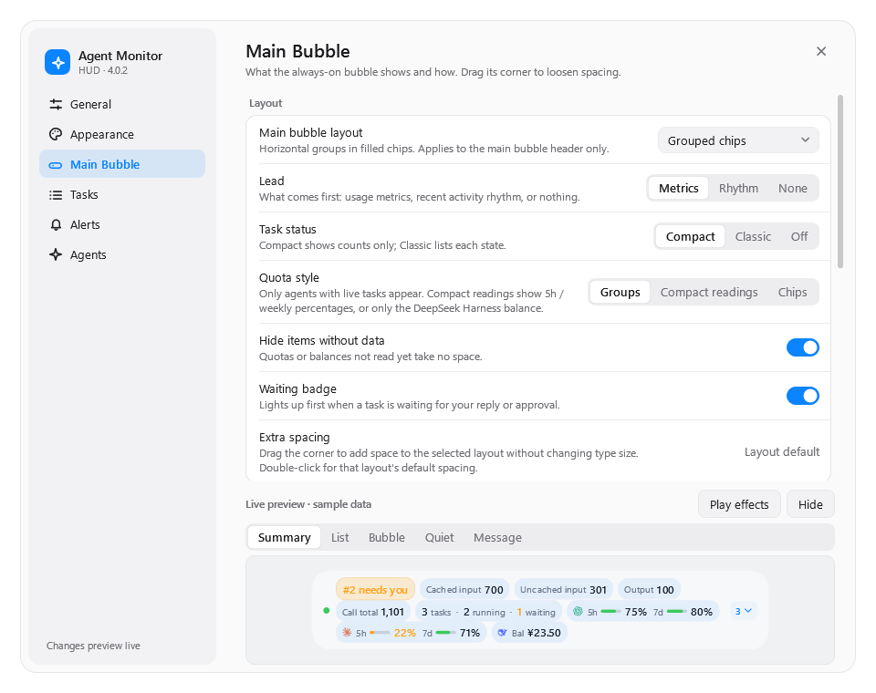

# Agent Monitor HUD

> [简体中文](README.zh-CN.md) · Windows x64 · formerly **Codex Monitor HUD**

A small, always-on-top overlay that shows what your coding agents are doing right now — **Codex**,
**Claude Code** and **DeepSeek Harness** — with token usage, context, task state and what's left of
your plan, all read locally.


> **4.0 is a complete rewrite.** The 3.x C#/WPF app (plus a bundled .NET runtime and a Node.js MCP
> host) was rewritten from scratch as one native Rust executable. The look, settings and plugin id stay the same.

The HUD, settings, Claude hooks and MCP server use the same native executable. There is no
bundled .NET runtime, Node.js host or WebView. See [the architecture](docs/ARCHITECTURE.md).

### Measured improvements

Migration measurements on the same Windows desktop:

| | 3.3.0 | 4.0.0 | Improvement |
| --- | --- | --- | --- |
| HUD private memory | ≈ 176 MiB | ≈ 12–13 MiB | **≈ 93% less** |
| HUD working set | ≈ 177 MiB | ≈ 30 MiB | **≈ 83% less** |
| App/runtime payload | ≈ 178 MB installed | ≈ 3.77 MB unpacked, including docs and screenshots | **≈ 98% smaller** |
| Recorded idle CPU | — | ≈ 0.2% of one logical core | |

The native executable is **2.38 MB**; the complete ZIP download is **1.49 MB**. Memory/CPU figures
were recorded during the October 24–25 migration; sizes come from the published v4.0.0 archive.
Memory rows cover the HUD process, excluding MCP helpers and agent applications.
[Measurement scope and exact sizes →](docs/PERFORMANCE.md)

## What it watches

| Agent | Surfaces | Plan / balance |
| --- | --- | --- |
| **Codex** | Desktop, VS Code, CLI, optional isolated DeepSeek CLI profile | 5-hour and weekly allowance |
| **Claude Code** | Desktop Code tab, CLI | 5-hour and weekly plan usage (from Claude Desktop's local samples) |
| **DeepSeek Harness** | Desktop | API balance (optional, needs your API key) |

Every task carries a source badge, so a Claude CLI task never looks like a Codex Desktop one.

## What you see

**Main bubble** — choose what leads:

- **Metrics**: cached / uncached input, output, call total, cost estimate.
- **Rhythm**: a sparkline of tokens per minute over the last 15/30/60 minutes, plus today's total
  and estimated cost.
- **None**: just status and quotas.

Followed by a compact task status (`2 tasks · 1 running · 1 waiting`) and quota groups: one small
meter per agent and window, turning amber and red as they run low. When a task needs your reply
or approval, a **waiting badge** lights up at the front.


**Task list** — expand the bubble into stable numbered rows with model, context use, cache hit
rate and lifecycle state. Rows can be split into independent bubbles, opened in Codex, or
dismissed.


**Notices** — agents can (with your opt-in) put a short, source-labelled notice on their task while
they keep working, through the bundled MCP tools.

**Drag the bubble's bottom-right corner** to loosen its spacing. Type never scales and the bubble
always stays one strip; double-click the grip to go back to tight.

## Settings

Six pages: General, Appearance (10 themes, type, opacity, colors), Main Bubble, Tasks, Alerts and
Agents. Changes preview live.



### DeepSeek balance (optional)

Settings → **Agents** → *DeepSeek API key*: paste your key and press **Save**. It is encrypted with
Windows DPAPI for your account, kept out of `settings.json`, never shown again (only the last four
characters), and sent only to `api.deepseek.com/user/balance`. **Remove** deletes it.

## Install

1. Download `AgentMonitorHUD-windows-x64.zip` and `SHA256SUMS.txt` from the
   [latest release](https://github.com/LH-03/agent-monitor-hud/releases/latest).
2. Check the hash and extract:

   ```powershell
   (Get-FileHash .\AgentMonitorHUD-windows-x64.zip -Algorithm SHA256).Hash
   Expand-Archive .\AgentMonitorHUD-windows-x64.zip -DestinationPath .\AgentMonitorHUD
   ```

3. Run the installer (no administrator rights needed):

   ```powershell
   powershell -NoProfile -ExecutionPolicy Bypass -File .\AgentMonitorHUD\scripts\install.ps1
   ```

It installs to `~/plugins/codex-monitor-hud`, creates *Agent Monitor HUD Settings* shortcuts on the
desktop and Start menu, registers the plugin for Codex, and — if Claude Code is installed — adds
the HUD's lifecycle hooks and MCP server to Claude Code (`-NoClaude` skips that).

Or hand the repository URL to Codex or Claude Code and say **"install this for me"**; the agent
procedure is in [INSTALL_WITH_AGENT.md](INSTALL_WITH_AGENT.md).

**Upgrading from 3.x** is automatic: your settings carry over, and the whole 3.x plugin folder is
kept as `~/plugins/.codex-monitor-hud-rollback-<version>`. To go back:

```powershell
powershell -NoProfile -ExecutionPolicy Bypass -File $HOME\plugins\codex-monitor-hud\scripts\rollback.ps1
```

**Uninstall** (settings are kept unless you add `-RemoveSettings`):

```powershell
powershell -NoProfile -ExecutionPolicy Bypass -File $HOME\plugins\codex-monitor-hud\scripts\uninstall.ps1
```

## Everyday controls

- Click the count pill to expand or collapse the task list.
- Drag the HUD anywhere; double-click it (or use the shortcut / tray icon) to open Settings.
- Detach one task, or **Split all**, from the HUD or the tray menu.
- If you enable mouse click-through, turn it off from the tray menu or ask your agent.

## Privacy

Everything stays on your machine. The HUD reads only counters and metadata (token usage, model,
lifecycle, workspace folder name, titles) — never prompts, replies or tool output — and does not
read provider config or credentials. The only network request is the optional DeepSeek balance.
See [PRIVACY.md](PRIVACY.md) and [SECURITY.md](SECURITY.md).

## Build from source

Requires Rust (pinned in `rust-toolchain.toml`) and the MSVC x64 build tools.

```powershell
cargo build --release
cargo test
powershell -NoProfile -ExecutionPolicy Bypass -File .\scripts\install.ps1
```

`AgentMonitorHUD.exe render-preview <dir>` renders the HUD and settings to PNGs without touching
your real state, which is how the screenshots here were made.

## Project status

Unofficial and independent; not affiliated with or endorsed by OpenAI, Anthropic or DeepSeek.
Cost figures are API-list-price estimates, not your subscription bill. Windows x64 only.

The 3.x history remains in this repository.

MIT License.
