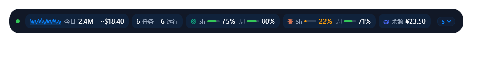
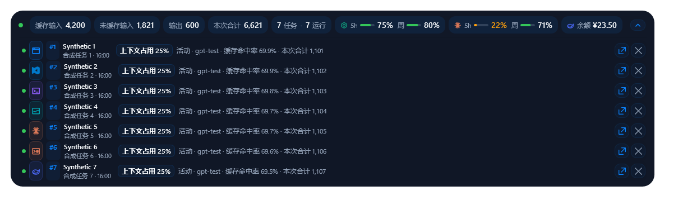
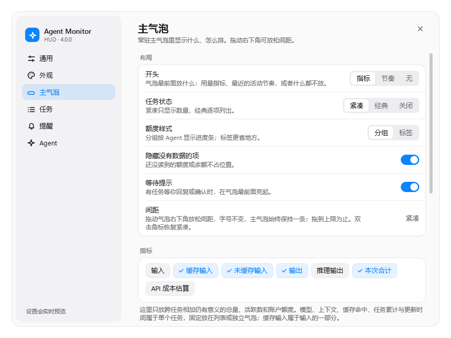
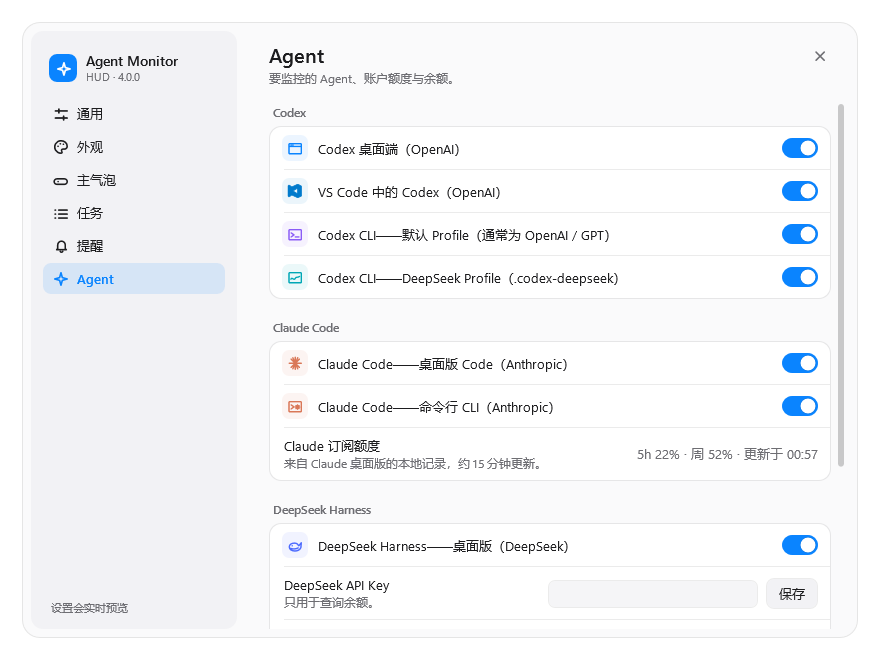

# Agent Monitor HUD

> [English](README.md) · Windows x64 · 原名 **Codex Monitor HUD**

一个常驻桌面最上层的小浮窗，实时显示你的编程 Agent 正在做什么——**Codex**、**Claude Code**、
**DeepSeek Harness**——包括 Token 用量、上下文、任务状态，以及套餐还剩多少，全部在本地读取。



> **4.0 是一次彻底重写。** 3.x 的 C#/WPF 程序（外加打包的 .NET 运行时和 Node.js MCP 宿主）由
> **Claude Opus 5.5**（Anthropic）在 Claude Code 中用 Rust 从零重写为单个原生可执行文件。外观、
> 设置和插件 ID 都保持不变。

HUD、设置窗口、Claude hooks 和 MCP 服务共用同一个原生程序，不再打包 .NET 运行时、Node.js
宿主或 WebView。实现方式见[架构说明](docs/ARCHITECTURE.md)。

## 监控范围

| Agent | 客户端 | 套餐 / 余额 |
| --- | --- | --- |
| **Codex** | 桌面端、VS Code、CLI、可选的独立 DeepSeek CLI Profile | 5 小时与周额度 |
| **Claude Code** | 桌面版 Code 标签页、CLI | 5 小时与周用量（读取 Claude 桌面版的本地记录） |
| **DeepSeek Harness** | 桌面版 | API 余额（可选，需要你自己的 API Key） |

每个任务前都有来源角标，Claude CLI 的任务不会被看成 Codex 桌面端的任务。

## 你会看到什么

**主气泡**——开头放什么可以自选：

- **指标**：缓存 / 未缓存输入、输出、本次合计、费用估算。
- **节奏**：最近 15/30/60 分钟每分钟 Token 的走势小图，以及今日累计和估算费用。
- **无**：只显示状态和额度。

后面是紧凑的任务状态（`2 任务 · 1 运行 · 1 等待`）和额度分组：每个 Agent、每个窗口一根小进度条，
快用完时依次变成琥珀色和红色。有任务在等你回复或确认时，最前面会亮起**等待提示**。


**任务列表**——展开后是编号稳定的任务行，显示模型、上下文占用、缓存命中率和生命周期状态。
任务可以拆成独立气泡、在 Codex 中打开，或从当前视图移除。



**主动通知**——经你同意后，Agent 可以通过自带的 MCP 工具，在自己的任务上贴一条带来源标记的
简短提示，同时继续在后台工作。

**拖动气泡右下角**可以放松间距。字号不会变，主气泡始终保持一条；双击角标恢复紧凑。

## 设置

六个页面：通用、外观（10 套主题、字号、透明度、颜色）、主气泡、任务、提醒、Agent。改动实时预览。





### DeepSeek 余额（可选）

设置 → **Agent** → *DeepSeek API Key*：粘贴你的 Key 后点**保存**。Key 用 Windows DPAPI 按当前用户
加密，不写进 `settings.json`，之后只显示末四位，并且只发送给 `api.deepseek.com/user/balance`。
点**移除**即可删除。

## 安装

1. 从[最新 Release](https://github.com/LH-03/agent-monitor-hud/releases/latest) 下载
   `AgentMonitorHUD-windows-x64.zip` 和 `SHA256SUMS.txt`。
2. 核对哈希并解压：

   ```powershell
   (Get-FileHash .\AgentMonitorHUD-windows-x64.zip -Algorithm SHA256).Hash
   Expand-Archive .\AgentMonitorHUD-windows-x64.zip -DestinationPath .\AgentMonitorHUD
   ```

3. 运行安装脚本（不需要管理员权限）：

   ```powershell
   powershell -NoProfile -ExecutionPolicy Bypass -File .\AgentMonitorHUD\scripts\install.ps1
   ```

安装位置是 `~/plugins/codex-monitor-hud`。脚本会在桌面和开始菜单创建 *Agent Monitor HUD Settings*
快捷方式，为 Codex 注册插件；如果装了 Claude Code，还会为它加上 HUD 的生命周期 hooks 和 MCP 服务
（加 `-NoClaude` 可跳过）。

也可以把仓库地址交给 Codex 或 Claude Code，说一句**“帮我安装”**；Agent 的安装流程见
[INSTALL_WITH_AGENT.md](INSTALL_WITH_AGENT.md)。

**从 3.x 升级**是自动的：设置会保留，整个 3.x 插件目录会完整保存为
`~/plugins/.codex-monitor-hud-rollback-<版本>`。想回退：

```powershell
powershell -NoProfile -ExecutionPolicy Bypass -File $HOME\plugins\codex-monitor-hud\scripts\rollback.ps1
```

**卸载**（默认保留设置，加 `-RemoveSettings` 一并删除）：

```powershell
powershell -NoProfile -ExecutionPolicy Bypass -File $HOME\plugins\codex-monitor-hud\scripts\uninstall.ps1
```

## 日常操作

- 点数量胶囊展开或收起任务列表。
- HUD 可以拖到任意位置；双击它（或用快捷方式、托盘图标）打开设置。
- 在 HUD 或托盘菜单里拆出单个任务，或者**全部拆分**。
- 开了鼠标穿透的话，从托盘菜单关闭，或让 Agent 帮你关。

## 隐私

所有数据都留在本机。HUD 只读取计数和元数据（Token 用量、模型、生命周期、工作目录名、标题），
从不读取提示词、回复或工具输出，也不读取 Provider 配置和凭据。唯一的网络请求是可选的 DeepSeek
余额查询。详见 [PRIVACY.md](PRIVACY.md) 和 [SECURITY.md](SECURITY.md)。

## 从源码构建

需要 Rust（版本固定在 `rust-toolchain.toml`）和 MSVC x64 构建工具。

```powershell
cargo build --release
cargo test
powershell -NoProfile -ExecutionPolicy Bypass -File .\scripts\install.ps1
```

`AgentMonitorHUD.exe render-preview <目录>` 可以把 HUD 和设置窗口离屏渲染成 PNG，不会碰你的真实
数据，本页截图就是这样生成的。

## 项目说明

非官方的独立项目，与 OpenAI、Anthropic、DeepSeek 没有关联，也未获其背书。费用数字是按公开 API
价格的估算，不是你的订阅账单。仅支持 Windows x64。

3.x 的历史仍保留在本仓库中。

MIT 许可证。
